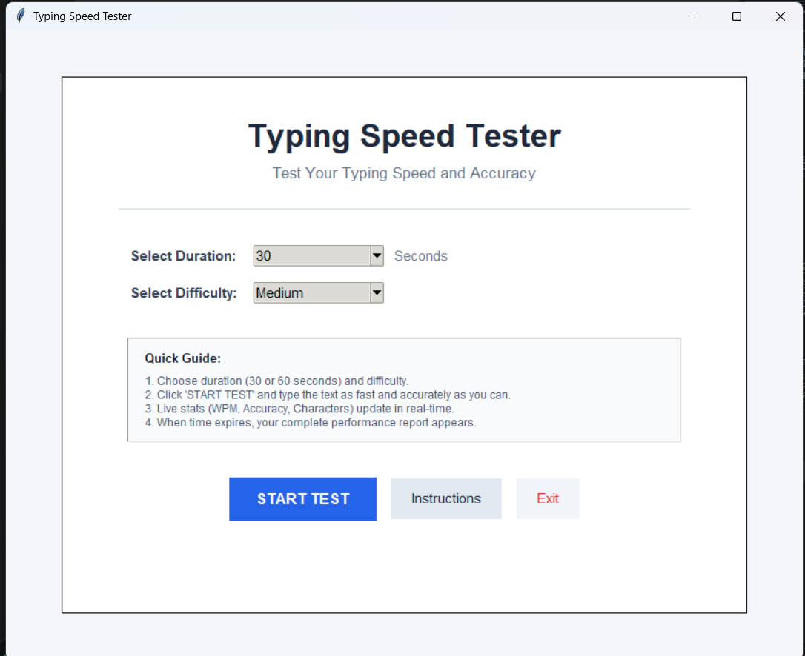
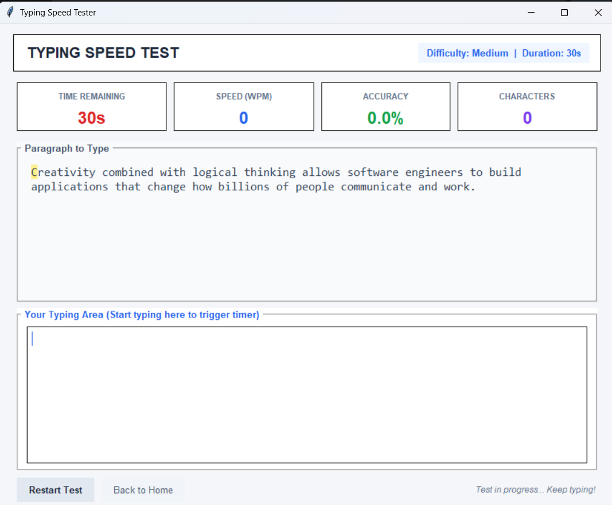
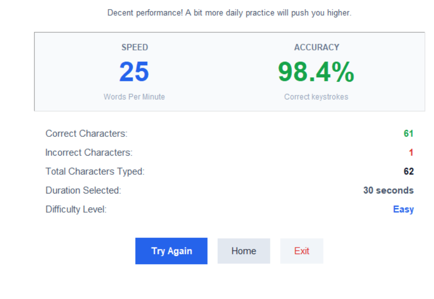

# ⌨️ Typing Speed Tester

A simple and user-friendly **Python Tkinter desktop application** that measures typing speed and accuracy through timed typing tests.

The application provides different difficulty levels and test durations while displaying real-time typing statistics such as **Words Per Minute (WPM), accuracy, correct characters, incorrect characters, and total characters**.

---

## 🚀 Features

- ⏱️ 30-second and 60-second typing tests
- 🎯 Three difficulty levels:
  - Easy
  - Medium
  - Hard
- 📊 Real-time WPM calculation
- 🎯 Real-time accuracy calculation
- 🔢 Character count tracking
- ✅ Correct character count
- ❌ Incorrect character count
- ⏰ Automatic countdown timer
- 📝 Multiple typing paragraphs for different difficulty levels
- 📋 Detailed results after completing the test
- 🔄 Try Again option
- 🏠 Return to Home option
- 📖 Built-in instructions
- 🚪 Exit option
- 💻 Completely offline application
- 📦 No external Python packages required

---

## 🛠️ Technologies Used

| Technology | Purpose |
|---|---|
| Python 3 | Main programming language |
| Tkinter | Graphical User Interface |
| Python Strings | Text processing and comparison |
| Functions | Program organization |
| Object-Oriented Programming | Application structure |
| Tkinter `after()` | Timer functionality |

---

## 📐 How It Works

The application displays a paragraph based on the selected difficulty level.

The user types the paragraph in the text box while the countdown timer is running.

During the test, the application continuously calculates:

- Typing speed
- Accuracy
- Correct characters
- Incorrect characters
- Total characters

When the timer reaches zero, the test automatically finishes and the final results are displayed.

---

## 📊 WPM Calculation

The typing speed is calculated using:

```text
WPM = (Characters Typed / 5) / Time in Minutes
```

---

## 🎯 Accuracy Calculation

Accuracy is calculated using:

```text
Accuracy = (Correct Characters / Total Typed Characters) × 100
```

The application compares the user's typed text with the original paragraph character-by-character.

---

## 🔍 Text Comparison

The application uses position-by-position string comparison.

For every typed character:

- If the character matches the original text → it is counted as **correct**
- If the character does not match → it is counted as **incorrect**
- Extra characters typed by the user are also counted as incorrect

This allows the application to calculate typing accuracy accurately.

---

## 🖥️ Application Screenshots

### 🏠 Home Screen

The Home Screen allows the user to select the test duration and difficulty level before starting the test.



---

### ⌨️ Typing Test Screen

The Typing Test Screen displays the paragraph, countdown timer, WPM, accuracy, and character statistics while the user types.



---

### 📊 Results Screen

The Results Screen displays the final typing performance, including WPM, accuracy, correct characters, incorrect characters, and total characters.



---

## 📁 Project Structure

```text
Typing-Speed-Tester/
│
├── typing_speed_tester.py
├── README.md
│
└── screenshots/
    ├── home.png
    ├── typing-test.png
    └── results.png
```

---

## ▶️ How to Run

### Step 1: Install Python

Make sure **Python 3** is installed on your computer.

### Step 2: Clone the Repository

```bash
git clone https://github.com/JoyalPatel29/Typing-Speed-Tester.git
```

### Step 3: Open the Project Folder

```bash
cd Typing-Speed-Tester
```

### Step 4: Run the Application

```bash
python typing_speed_tester.py
```

The Typing Speed Tester desktop application will open.

---

## 💻 Requirements

- Python 3.x
- Tkinter

Tkinter is included with most standard Python installations.

**No external Python packages are required.**

---

## 🎓 Learning Objectives

This project demonstrates practical use of fundamental Python programming concepts, including:

- Variables and data types
- Strings
- String comparison
- Functions
- Conditional statements
- Loops
- Event handling
- GUI programming
- Object-oriented programming
- Timers
- User input handling

---

## 🎯 Project Objectives

The main objectives of this project are:

1. To develop a simple typing practice application.
2. To calculate typing speed in Words Per Minute (WPM).
3. To calculate typing accuracy.
4. To provide different typing difficulty levels.
5. To implement a graphical interface using Tkinter.
6. To practice Python functions, strings, and event-driven programming.
7. To create a completely offline desktop application.

---

## 🔮 Future Improvements

Possible future improvements include:

- User score history
- Personal best tracking
- More typing passages
- Custom typing passages
- More difficulty levels
- Sound effects
- Dark mode
- Typing performance charts
- User profiles

---

## 👨‍💻 Author

**Joyal Patel**

GitHub: [JoyalPatel29](https://github.com/JoyalPatel29)

---

## 📌 Project Information

| Detail | Information |
|---|---|
| Project Name | Typing Speed Tester |
| Language | Python 3 |
| GUI Framework | Tkinter |
| Application Type | Desktop Application |
| Mode | Offline |
| Project Type | College Mini Project |

---

## ⭐ Acknowledgement

This project was developed as a Python mini-project to practice GUI development, string processing, functions, timers, and basic object-oriented programming.

---

⭐ **If you find this project useful, consider giving the repository a star!**